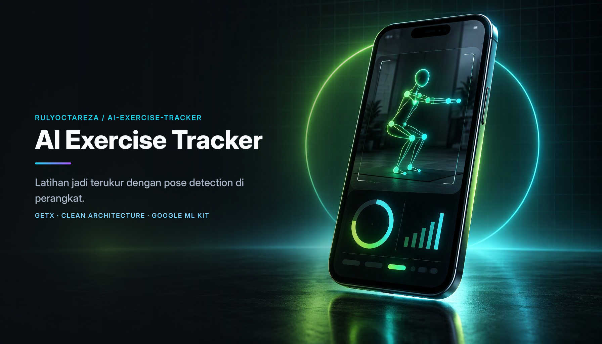

<p align="center">
  
</p>

<h1 align="center">AI Exercise Tracker</h1>

<p align="center">
  <b>Latihan jadi terukur dengan pose detection di perangkat.</b><br>
  GetX · Clean Architecture · Google ML Kit
</p>

<p align="center">
  <a href="https://flutter.dev"></a>
  <a href="https://pub.dev/packages/get"></a>
  
  <a href="https://firebase.google.com"></a>
</p>

---

## ✨ Preview

<p align="center">
  
</p>

> **Catatan:** gambar di atas adalah *ilustrasi konsep*, bukan screenshot asli.

---

## 📖 Tentang

AI Exercise Tracker memakai kamera ponsel dan **Google ML Kit Pose Detection** untuk membaca
gerakan tubuh secara real-time. Hasil latihan dicatat, ditampilkan dalam grafik, dan disimpan
ke cloud — dibangun dengan **GetX** dan **Clean Architecture** agar tiap lapisan tetap terpisah.

---

## 🌟 Fitur

- 🎥 **Pose detection real-time** lewat kamera (`google_mlkit_pose_detection`)
- 🏋️ **Pelacakan latihan** dengan hitungan dan riwayat sesi
- 📊 **Grafik progres** menggunakan `fl_chart`
- 🔐 **Autentikasi** Firebase Auth
- ☁️ **Penyimpanan data** di Cloud Firestore
- ✨ Animasi Lottie dan ilustrasi SVG
- 📱 State management GetX + routing

---

## 🛠️ Tech Stack

| Area | Pilihan |
|---|---|
| Framework | Flutter |
| State management | GetX |
| Arsitektur | Clean Architecture |
| Computer vision | Google ML Kit Pose Detection |
| Backend | Firebase Auth + Cloud Firestore |
| Grafik | `fl_chart` |
| Penyimpanan lokal | `shared_preferences` |

---

## 🧱 Struktur

```text
lib/
├── core/          # Konstanta, error, utilitas
├── data/          # Model, datasource, repository implementation
├── domain/        # Entity, use case, repository interface
├── presentation/  # Screen, widget, controller GetX
├── routes/        # Definisi halaman
├── services/      # Layanan kamera, ML, dan Firebase
└── main.dart
```

---

## 🚀 Menjalankan

```bash
flutter pub get
flutter run
```

Butuh perangkat fisik dengan kamera; konfigurasi Firebase mengikuti `firebase.json` di repo.

---

## 🧪 Testing

```bash
flutter analyze
flutter test
```
